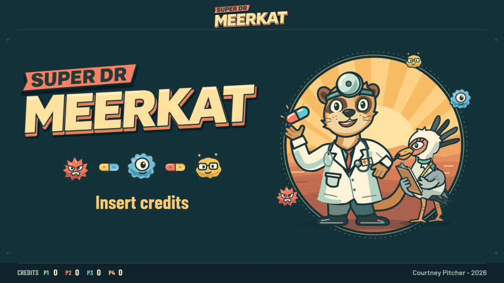
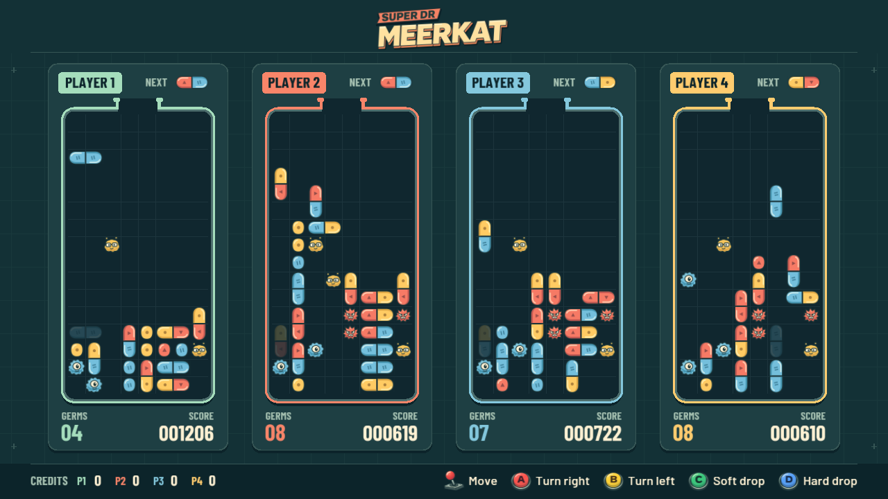

# Super Dr Meerkat

An arcade game for one to four players, inspired by Dr. Mario. Drop capsules to clear germs by matching four of the same colour in a row or column.




[Cover art, boxes and logos for scrapers](https://github.com/IgniparousTempest/libretro-superdrmeerkat/tree/master/.artwork)

## Installation

Download the [release archive](https://github.com/IgniparousTempest/libretro-superdrmeerkat/releases) for your system. Extract it and run `./super-dr-meerkat` (`super-dr-meerkat.exe` on Windows).

Set `max_players` and `resolution` in `super-dr-meerkat.toml`.

## RetroArch

Copy `superdrmeerkat_libretro` (`.so`, `.dll` or `.dylib`) to RetroArch’s cores directory and its `.info` file to the core info directory. With an OpenGL video driver, choose **Load Core → Super Dr Meerkat → Start Core**, or load `super-dr-meerkat.toml` as content to use your cabinet settings. **Select** inserts a credit and **Start** joins on each controller. High scores go in RetroArch’s save directory.

- **RetroPie** — Extract the matching Pi archive into `~/RetroPie/roms/ports/`. From `ports/`, run `mv super-dr-meerkat/frontends/retropie.sh 'Super Dr Meerkat.sh'`. Restart EmulationStation and open **Ports**.
- **Recalbox** — Extract the matching Pi archive into `/recalbox/share/roms/`. Copy `super-dr-meerkat/frontends/recalbox-systemlist.xml` to `/recalbox/share/system/.emulationstation/systemlist.xml`. If that file exists, add just the `<system>` element to its `<systemList>`. Restart EmulationStation and open **Ports**.

## Building from source

```sh
sudo apt install build-essential libsdl2-dev python3
make config
cargo run --release --locked
```

Build the core with `cargo build --release --locked -p superdrmeerkat-libretro`.
